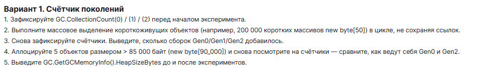
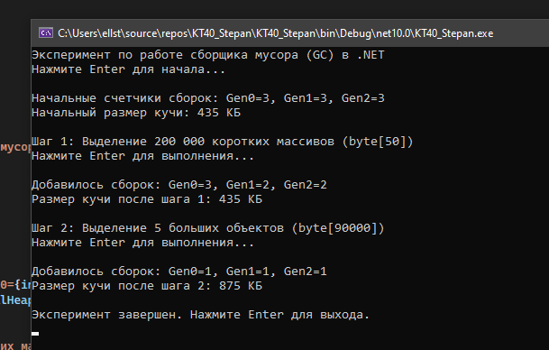

# КТ40: ВАРИАНТ 1

В этой контрольной точке нужно было разобраться, как работает сборщик мусора в .NET - эта штука, которая автоматически очищает память от ненужных объектов. Я написал программу, которая проводит два эксперимента: сначала создаёт кучу маленьких объектов, потом несколько больших, и смотрит, как GC на это реагирует.

Как работает программа:
Программа состоит из двух шагов:

Шаг 1 - короткие объекты. Я создаю 200 000 массивов по 50 байт каждый. Ссылки на них не сохраняю - они сразу становятся мусором. Эти объекты маленькие (меньше 85 КБ), поэтому попадают в **нулевое поколение (Gen0)**. GC их быстро находит и удаляет.
Шаг 2 - большие объекты. Создаю 5 массивов по 90 000 байт и сохраняю ссылки на них в списке. Поскольку размер больше 85 КБ, они попадают в Large Object Heap (LOH) - специальную область для больших объектов, которая является частью **второго поколения (Gen2)**.

Какие методы использовал:

`GC.CollectionCount(0/1/2)` - показывает, сколько раз GC запускался для каждого поколения (Gen0, Gen1, Gen2)
`GC.GetTotalMemory(true)` - возвращает точный размер выделенной памяти. Параметр `true` заставляет GC сначала убрать весь мусор, чтобы замер был честным
`GC.GetGCMemoryInfo().HeapSizeBytes` - альтернативный способ получить размер кучи (в задании упомянут, но я использовал GetTotalMemory, он точнее для экспериментов)

## Разбор каждой строки вывода

Ниже иду по выводу консоли сверху вниз и объясняю каждую строку: что она значит и откуда в ней такие числа.

**1. `Эксперимент по работе сборщика мусора (GC) в .NET`**
Заголовок, который печатается первым делом, чтобы было видно, какая программа запущена. Замеров здесь ещё нет.

**2. `Нажмите Enter для начала...`**
Программа доходит до `Console.ReadLine()` и ждёт, пока я нажму Enter. Пауза нужна, чтобы вывод не смешивался с моментом загрузки программы и чтобы я успевал прочитать напечатанное.

**3. `Начальные счетчики сборок: Gen0=3, Gen1=3, Gen2=3`**
Это накопленные значения `GC.CollectionCount(0)`, `(1)` и `(2)` на момент старта: к этому времени GC уже отработал 3 раза в каждом поколении. Числа одинаковые, потому что полная сборка Gen2 одновременно считается и сборкой Gen1, и сборкой Gen0, то есть до старта происходили только полные сборки. Эти три числа запоминаются как точка отсчёта: дальше во всех строках показывается не сам счётчик, а его прирост.

**4. `Начальный размер кучи: 435 КБ`**
Результат `GC.GetTotalMemory(true)`, то есть сколько памяти занято прямо сейчас. Параметр `true` заставляет GC сначала убрать весь мусор, поэтому замер честный. 435 КБ - это не массивы, их ещё нет: столько занимает сам .NET (загруженные библиотеки, данные JIT, служебные структуры рантайма).

**5. `Шаг 1: Выделение 200 000 коротких массивов (byte[50])`**
Печатается, что сейчас будет делаться, чтобы следующий блок чисел было к чему отнести.

**6. `Нажмите Enter для выполнения...`**
Снова пауза до Enter. Так шаги разделены: пока Enter не нажат, выделения не начались, и видно, какие числа были до них.

**7. `Добавилось сборок: Gen0=3, Gen1=2, Gen2=2`**
Главная строка шага 1. Здесь из текущих счётчиков вычитаются стартовые, и получается, сколько сборок добавилось за время шага: в Gen0 - 3, в Gen1 - 2, во Gen2 - 2. Читается так: GC трижды запускался по мелкому мусору, из этих запусков два дошли до Gen1 и два до дорогого Gen2.

Сколько всего было выделено: 200 000 массивов по 80 байт (50 байт данных плюс 24 байта заголовка объекта и выравнивание), итого около 15,3 МБ. То есть 15,3 МБ мусора дали всего несколько сборок.

Отдельно отмечу: одна из этих трёх сборок - принудительная, её вызывает сам `GC.GetTotalMemory(true)` из строки замера, которая идёт следующей. Поэтому чистого прироста от цикла меньше: две сборки Gen0 и по одной Gen1 и Gen2.

**8. `Размер кучи после шага 1: 435 КБ`**
Ключевой результат шага. Было 435 КБ, стало 435 КБ, изменение 0 КБ. Значит, все 15,3 МБ мусора GC убрал полностью и память вернулась ровно к начальному значению. Так произошло потому, что ссылки на массивы не сохранялись: все 200 000 штук сразу стали недостижимыми, а недостижимые объекты GC удаляет без вопросов.

Здесь же видна разница между "сколько выделено" и "сколько занято": выделено было 15,3 МБ, а занято в итоге 0. Поэтому в строке стоит 435 КБ, а не 15 МБ.

**9. `Шаг 2: Выделение 5 больших объектов (byte[90000])`**
Объявление второго шага. 90 000 байт больше порога 85 000, поэтому каждый такой массив попадёт не в обычную часть кучи, а в LOH.

**10. `Нажмите Enter для выполнения...`**
Пауза, чтобы второй шаг начался отдельно от первого.

**11. `Добавилось сборок: Gen0=1, Gen1=1, Gen2=1`**
За шаг 2 добавилась ровно одна сборка в каждом поколении, и это одна и та же полная сборка, та самая принудительная, которую выполняет `GC.GetTotalMemory(true)` при замере. Сами пять массивов по 90 000 байт не вызвали ни одной сборки: 450 КБ уместились в бюджет LOH, и вмешиваться GC не понадобилось.

Сравнение с шагом 1 получается наглядным: мелкого мусора было 15,3 МБ, и он вызвал несколько сборок Gen0; крупных объектов 440 КБ, и они не вызвали ни одной.

**12. `Размер кучи после шага 2: 875 КБ`**
Было 435 КБ, стало 875 КБ, прирост 440 КБ. Проверка расчётом: 5 массивов по 90 024 байта (90 000 данных плюс 24 байта заголовка) дают 450 120 байт, то есть примерно 440 КБ. Совпадает, значит выросли ровно эти массивы и ничего лишнего.

Память не вернулась к прежнему значению, потому что ссылки на этот раз сохранены в `List<byte[]>`. Объекты достижимы, а достижимые объекты GC удалять не имеет права. И так как размер больше 85 000 байт, лежат они в LOH, которая относится к Gen2, поэтому вместе с мелким мусором они не убираются.

**13. `Эксперимент завершен. Нажмите Enter для выхода.`**
Финальная строка и последняя пауза. Без неё окно консоли закрылось бы сразу после завершения программы, и вывод не удалось бы прочитать.

Задания:

Вывод в консоль

